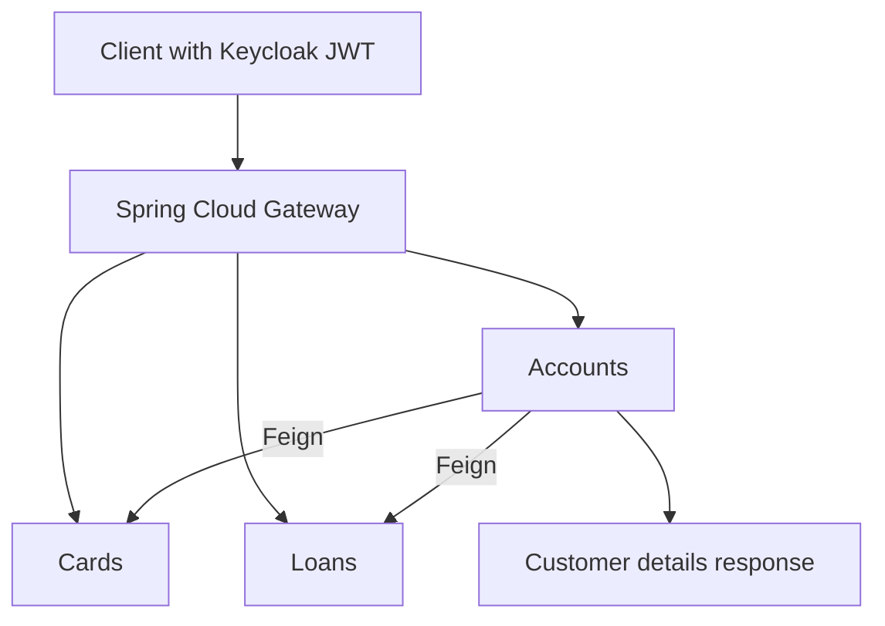

# myBank — Banking Microservices
### One customer view across accounts, cards, and loans.

Banking information is often split across services. myBank exposes account, card, and loan operations behind a common gateway, with service discovery and centralized configuration. A client can create an account, fetch it by mobile number, or request a customer view enriched with card and loan details.

This is my learning project for building and operating Spring Cloud services. The services share a repository so their interactions can be explored together.

## Follow a request across the system

- **A gateway that handles failure deliberately.** Explicit routes forward `/mybank/accounts/**`, `/mybank/cards/**`, and `/mybank/loans/**` to discovered services. The accounts route has a circuit breaker and fallback; route filters, timeouts, and Keycloak JWT role checks sit at the entry point.
- **A customer view assembled through service calls.** The accounts service uses Feign clients to request card and loan data. Eureka resolves service instances, while Spring Cloud Config supplies environment-specific settings.
- **Observe the work after the request.** Compose includes Prometheus metrics, Grafana dashboards, Loki logging, and Tempo tracing with OpenTelemetry configuration. Kafka and Spring Cloud Stream connect the event sender and accounts processing.



Start with the [gateway routes](gatewayserver/src/main/java/com/mybank/gatewayserver/GatewayserverApplication.java), [customer aggregation](accounts/src/main/java/com/mybank/accounts/service/impl/CustomersServiceImpl.java), and [observability configuration](docker-compose/observability-monitoring/).

## Run the development stack

Prerequisites: Git, Docker Compose, and enough memory for the application and monitoring containers. Source builds use JDK 21 and each service's Maven wrapper.

```bash
git clone https://github.com/Jabour-Salahddine/myBank-Microservices.git
cd myBank-Microservices/docker-compose/default
docker compose up -d
docker compose ps
```

Compose references prebuilt `jsalahddine/*:v10` application images, so startup also depends on their availability. The Config Server uses a Git configuration backend; review [its settings](configserver/src/main/resources/application.yml). The repository includes separate `default`, `qa`, and `prod` Compose configurations.

| Tool | Address | Use |
| --- | --- | --- |
| Gateway | http://localhost:8072 | Application entry point |
| Eureka | http://localhost:8070 | Registered service instances |
| Config Server | http://localhost:8071 | Service configuration |
| Keycloak | http://localhost:7080 | Local identity and role configuration |
| Grafana | http://localhost:3000 | Metrics, logs, and traces |
| Prometheus | http://localhost:9090 | Metrics queries |

Configure the Keycloak client and assign realm roles `ACCOUNTS`, `CARDS`, or `LOANS` for the routes you want to use. The Compose stack uses development credentials and anonymous Grafana administration; use it as a local learning environment.

With a token that has the `ACCOUNTS` role:

```bash
curl -H "Authorization: Bearer $ACCESS_TOKEN"   "http://localhost:8072/mybank/accounts/api/accounts/fetchCustomerDetails?mobileNumber=YOUR_MOBILE_NUMBER"
```

Create the customer/account first using the [accounts routes](accounts/src/main/java/com/mybank/accounts/controller/AccountsController.java). The aggregation request follows the Feign calls shown above.

## Build or inspect a service

From the repository root:

```bash
cd accounts
sh ./mvnw clean package
```

Use the same pattern for `cards`, `loans`, `configserver`, `eurekaserver`, `gatewayserver`, or `eventsender`. From a Compose environment directory, use `docker compose logs -f accounts` to follow a service and `docker compose down` to stop that environment.
